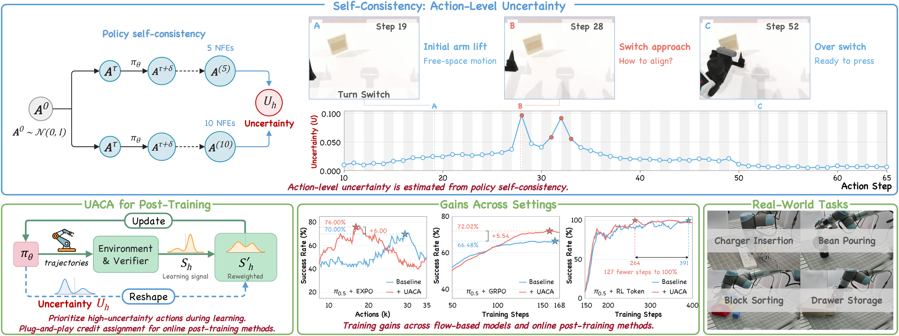

# simple annotation revision

2026-10-22. A is the current simple figure. All variants use the annotated vertical, coaxial uncertainty routing.

- A: closest to the annotation; fine gray photo borders.
- B: slightly more circle-label spacing; fine gray borders.
- C: intermediate spacing; pale blue borders.

[Editable Draw.io](UACA_head_simple_annotation_variants.drawio) contains A, B, C and the user-annotated input page.

| A | B | C |
|---|---|---|
|  |  |  |
