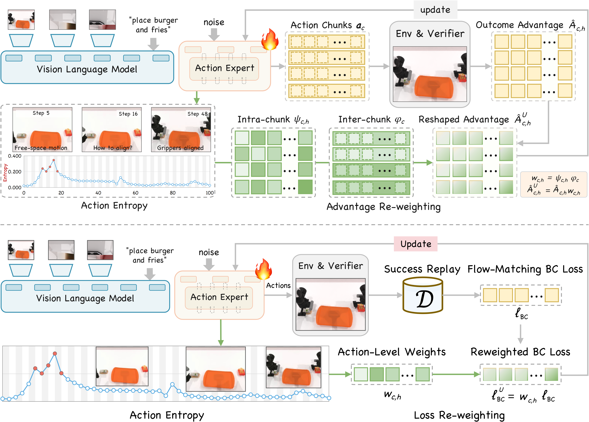
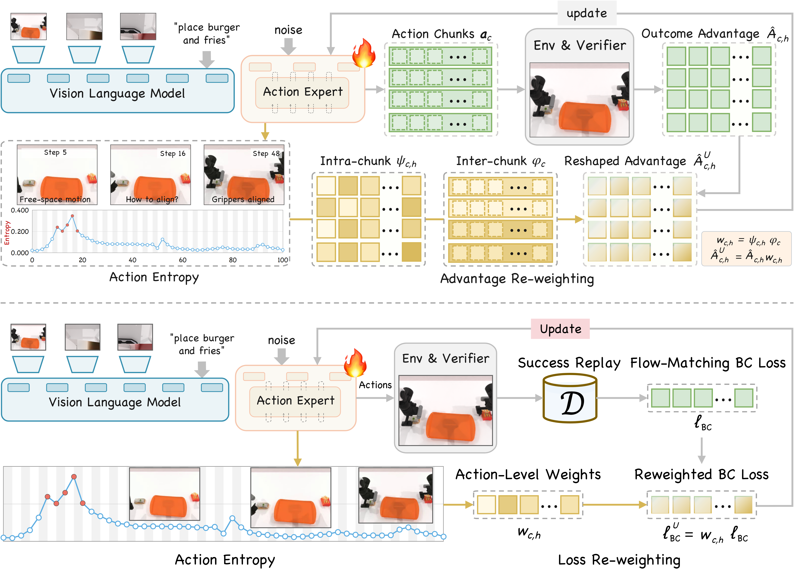

# UACA main figure drafts · 2026-10-24

[Editable main figure, 4 pages](UACA_main_draft.drawio) · [Editable detail comparisons](UACA_main_detail_checks.drawio)

P04: user-supplied yellow for action chunks and original learning signals, green for weights. P05: the two colors exchanged. The original annotated page is preserved at the end of the main file.

[Gradient comparison](previews/gradient_reference_comparison.png) · [Upper signal](previews/current_grpo_detail.png) · [Lower signal with embedded photos](previews/current_bc_detail.png)

[Analysis figure drafts](../analysis_20261024/)
