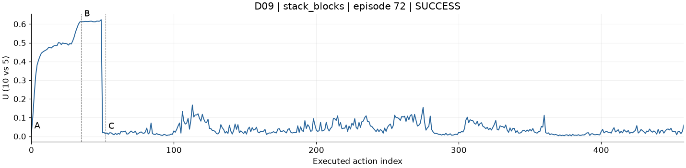
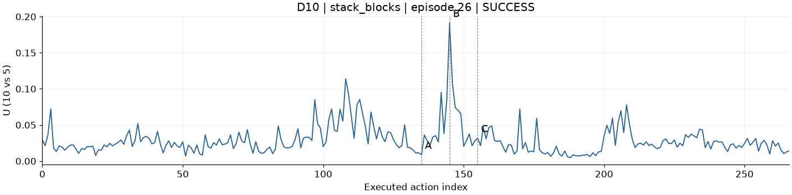
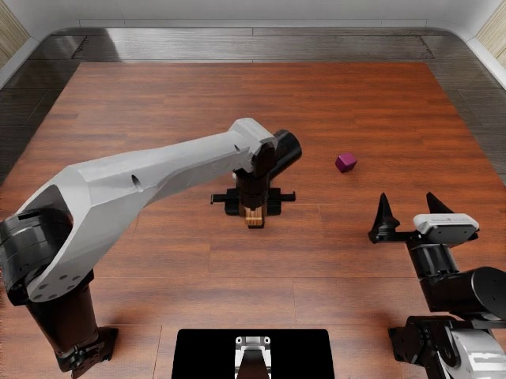
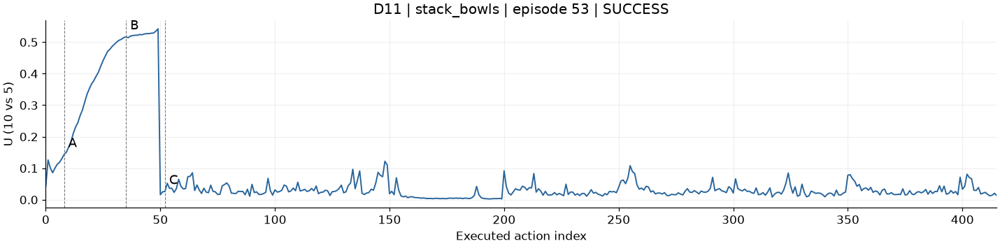
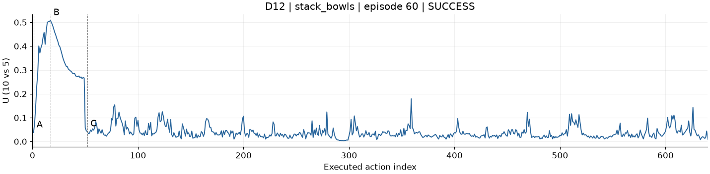

# Dojo：4条已选成功轨迹

2026-10-20用户从Dojo图册确认的绘图材料。保留原编号、完整逐动作U和A/B/C真实选帧。

| 编号 | 任务 | episode | layout seed / layout ID | 已执行动作 | 预测块 |
|---|---|---:|---|---:|---:|
| [D09](D09/series.json) | stack_blocks | 72 | 0 / 24 | 459 | 10 |
| [D10](D10/series.json) | stack_blocks | 26 | 2 / 8 | 267 | 6 |
| [D11](D11/series.json) | stack_bowls | 53 | 2 / 17 | 416 | 9 |
| [D12](D12/series.json) | stack_bowls | 60 | 0 / 20 | 641 | 13 |

每条均成功。episode是采集编号；真实布局编号单列，避免与模型seed混淆。

## 直接画图

- `Dxx/action_u.csv`：完整已执行动作的 action_index/query/h/U，最简输入。
- `Dxx/series.json`：完整曲线、已选A/B/C动作与每相机真实帧号；`curve.svg`、`curve.png`是已确认的现成曲线。
- `Dxx/A_*.jpg`、`B_*.jpg`、`C_*.jpg`：3时刻 × 3相机，共9张真实帧；两张`contact_*.jpg`便于查看。
- `Dxx/videos/`：原生完整主相机、左腕、右腕视频，共12段；`episode.mp4`另为保留所有帧的浏览器可播放主相机版本。
- `Dxx/raw/`：全部query原始NPZ（M10/M5最终动作、初始噪声、U、有效标记、RNG、环境动作）、输入观测NPZ、逐query提示和元数据、actions.jsonl、frames.jsonl、episode.json。
- `Dxx/scene_layout.json`：真实场景布局；`runs/`：两组运行配置、命令、日志、原生结果、验证及主策略一致性记录。
- `source/`：采集/记录/U计算与图册导出源码快照；`source-manifest.json`保留服务器来源路径和大小。

## U与对齐

U沿用已验证的定义：同一输入、同一初始噪声，完整M10与完整M5生成动作在归一化模型前14个真实坐标上的相对差异；主执行M10，预测H50。数学实现见`source/tools/pi05_signals/signal_math.py`的`ugrow_10_vs_5`。

按已执行动作 `action_index → query/h → control_tick → frame` 对齐；帧取相应动作结束附近，保留真实帧号。曲线无平滑、不是块均值，不包含最后一块未执行尾部。首块之后的U突变可能同时受重新观察影响；这些是用户选定的成功可视化案例。

原始JSON保留服务器绝对路径用于溯源；本地读取请使用本目录相对路径。无需访问服务器即可画图。用任意静态HTTP服务打开`index.html`可查看原风格图册，点击A/B/C定位主相机视频。

## 预览

### D09

### D10

### D11

### D12

